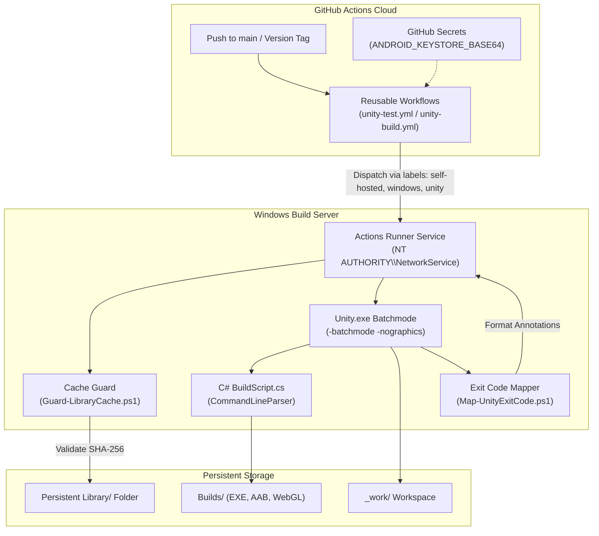

# unity-build-pipeline

Self-hosted GitHub Actions pipeline for Unity: Windows runner provisioning, Library caching, EditMode and PlayMode tests, Windows, Android and WebGL builds, keystore signing and versioned releases.

[](https://github.com/thesanketkale/unity-build-pipeline/actions/workflows/ci.yml)
[](https://github.com/thesanketkale/unity-build-pipeline/releases)
[](LICENSE)

---

## 1. Why It Exists

Building Unity games and XR experiences in continuous integration presents extreme bottlenecks: an average-sized Unity project can take **30 to 90 minutes** to re-import its asset `Library/` from scratch on a clean cloud runner. Furthermore, standard cloud-hosted Linux CI runners (such as GameCI running in Docker) cannot natively compile **Windows Standalone IL2CPP** binaries or run DirectX-specific graphics tests.

`unity-build-pipeline` turns any spare Windows workstation or dedicated server into an ultra-fast, production-grade Unity build runner in about **ten minutes**. By combining a dedicated Windows Service runner, persistent local NVMe caching, a cryptographic cache guard, and reusable GitHub Actions workflows, incremental builds and tests drop to **2 to 4 minutes**.

### Honest Comparison with Alternatives

- **vs GameCI:** GameCI excels at containerized builds on hosted Linux runners for Android, WebGL, and Linux targets without managing physical hardware. However, downloading multi-gigabyte cache tarballs across the network incurs heavy delays, and Linux runners cannot build Windows IL2CPP players. `unity-build-pipeline` is designed specifically for teams using self-hosted Windows hardware to achieve zero-cost runner minutes and maximum compilation speed. (See detailed [Modes Comparison](docs/modes-comparison.md)).
- **vs Unity Cloud Build (UCB):** UCB is a turnkey SaaS platform, but features opaque queue times, limited customization for proprietary signing/release scripts, and recurring subscription tiers. `unity-build-pipeline` gives you 100% control over your build hardware, scripts, and deployment targets.

---

## 2. Features

- **Ten-Minute Automated Setup:** PowerShell 7 provisioning scripts (`install-runner.ps1`, `install-unity.ps1`) configure the Actions runner service, Unity Hub, and target Editor modules idempotently.
- **Intelligent Library Cache Guard:** `scripts/Guard-LibraryCache.ps1` hashes `manifest.json`, `packages-lock.json`, and `ProjectVersion.txt` to keep the local `Library/` intact for incremental builds, while purging safely when dependencies change.
- **Multiplatform Reusable Workflows:** Ready-to-use `workflow_call` pipelines for:
  - **EditMode & PlayMode Tests:** Headless batchmode execution with NUnit XML reports summarized in GitHub Actions.
  - **Windows Standalone:** Native 64-bit compilation with Mono or IL2CPP scripting backends.
  - **Android:** Automated generation of `.apk` or `.aab` packages with base64 keystore signing and ephemeral secret cleanup.
  - **WebGL:** Canvas build packaging and optimization.
- **Human-Readable Diagnostics:** `scripts/Map-UnityExitCode.ps1` translates Unity's batchmode exit codes into clear descriptions and GitHub Actions step annotations.
- **Semantic Versioning & Bundle Codes:** Automatically derives SemVer tags and monotonically increasing integer `bundleVersionCode` values for Google Play.
- **Strict Security Guardrails:** Runner runs as a dedicated non-admin service account, third-party actions are pinned to 40-character commit SHAs, and untrusted fork PR execution is strictly blocked.

---

## 3. Quickstart (Five Commands to a Working Runner)

From a clean Windows 10/11 or Server machine running PowerShell 7 as Administrator:

```powershell
# 1. Clone repository
git clone https://github.com/thesanketkale/unity-build-pipeline.git C:\unity-build-pipeline
Set-Location C:\unity-build-pipeline

# 2. Provision Windows Actions Runner Service
pwsh -ExecutionPolicy Bypass -File .\runner\install-runner.ps1 -RepoUrl "https://github.com/your-org/your-repo" -Token "YOUR_GITHUB_TOKEN"

# 3. Install Unity Hub & Target Editor with Android, Windows IL2CPP, and WebGL modules
pwsh -ExecutionPolicy Bypass -File .\runner\install-unity.ps1 -ProjectVersionFile "samples/minimal-project/ProjectSettings/ProjectVersion.txt"

# 4. Activate Unity License
pwsh -ExecutionPolicy Bypass -File .\runner\license.ps1 -Action Activate -Serial "SC-XXXX-..." -Username "ci@org.com" -Password "secret"

# 5. Verify Local Test Harness
pwsh -NoProfile -ExecutionPolicy Bypass -File .\scripts\verify.ps1 full
```

---

## 4. Architecture Overview



---

## 5. Configuration Reference Table

### Reusable Workflow Inputs (`unity-test.yml` & `unity-build.yml`)

| Input Name | Type | Default | Description |
|---|---|---|---|
| `project-path` | string | `"."` | Path to the Unity project root relative to repository. |
| `unity-version` | string | `""` | Target Unity version. If omitted, resolved from `ProjectVersion.txt`. |
| `test-platforms` | string | `"EditMode,PlayMode"` | Comma-separated test platforms for `unity-test.yml`. |
| `build-targets` | string | `'["StandaloneWindows64", "Android", "WebGL"]'` | JSON array of build platforms for `unity-build.yml`. |
| `build-method` | string | `"UnityBuildPipeline.BuildScript.PerformBuild"` | Static C# method executed via `-executeMethod`. |
| `android-build-format` | string | `"AAB"` | Format for Android builds: `"AAB"` (App Bundle) or `"APK"`. |
| `runner-labels` | string | `'["self-hosted", "windows", "unity"]'` | JSON array of GitHub runner labels. |
| `clean-library` | boolean | `false` | Force purges the local `Library/` directory before building. |

---

## 6. Usage Examples

### Running Tests in CI
Add `.github/workflows/test.yml` to your Unity repository:

```yaml
name: Test Unity Project
on:
  push:
    branches: [main]
  workflow_dispatch:

permissions: {}

jobs:
  tests:
    name: Run EditMode & PlayMode Tests
    uses: thesanketkale/unity-build-pipeline/.github/workflows/unity-test.yml@v0.1.0
    with:
      project-path: "."
      test-platforms: "EditMode,PlayMode"
```

### Multiplatform Build & Keystore Signing
Add `.github/workflows/build.yml` to your Unity repository:

```yaml
name: Build Game Packages
on:
  push:
    branches: [main]
  workflow_dispatch:

permissions: {}

jobs:
  build:
    name: Build Multiplatform Players
    uses: thesanketkale/unity-build-pipeline/.github/workflows/unity-build.yml@v0.1.0
    with:
      project-path: "."
      build-targets: '["StandaloneWindows64", "Android", "WebGL"]'
      android-build-format: "AAB"
    secrets:
      ANDROID_KEYSTORE_BASE64: ${{ secrets.ANDROID_KEYSTORE_BASE64 }}
      ANDROID_KEYSTORE_PASS: ${{ secrets.ANDROID_KEYSTORE_PASS }}
      ANDROID_KEYALIAS_NAME: ${{ secrets.ANDROID_KEYALIAS_NAME }}
      ANDROID_KEYALIAS_PASS: ${{ secrets.ANDROID_KEYALIAS_PASS }}
```

---

## 7. Troubleshooting & FAQ

- **Unity fails with exit code 1 / License handshake error:**
  Ensure the host machine license is activated. Run `pwsh -File .\runner\license.ps1 -Action Status`. See [Licensing Guide](docs/licensing.md).
- **Unity reports "Another instance of Unity is running on this project":**
  Workflows enforce strict single-job concurrency (`cancel-in-progress: false`). If an earlier run was aborted forcefully, delete `Temp/UnityLockfile`.
- **Display: No graphic device found with `-nographics`:**
  Install DirectX runtimes and update graphics drivers on the Windows build machine. See [Troubleshooting Guide](docs/troubleshooting.md).

---

## 8. Security Notes & Known Limitations

> [!WARNING]
> **CRITICAL SECURITY WARNING: NEVER EXECUTE UNTRUSTED PULL REQUESTS ON SELF-HOSTED RUNNERS.**  
> In public repositories, pull requests from forks can execute arbitrary code on the build machine. Reusable workflows in this repository trigger strictly on `push` to protected branches and manual `workflow_dispatch`. Configure your repository settings to require approval for outside collaborators.

- **Dedicated Service Account:** Runner service runs under `NT AUTHORITY\NetworkService` or a dedicated local user account (`.\UnityRunner`), not `LocalSystem` or Administrator.
- **Action Pinning:** All third-party GitHub Actions are pinned to verified 40-character commit SHAs.
- **Ephemeral Keystores:** Android keystore materials are decoded into secure temporary files and wiped unconditionally in `if: always()` steps.
- **Known Limitations:**
  - Direct store uploading (Google Play Store API, Steamworks, Meta Quest App Lab) is out of scope for v0.1.0 and tracked on the roadmap.
  - Unity Cloud Diagnostics and Addressables cloud hosting are planned for future releases.

---

## 9. Verification Status

This repository strictly separates automated CI verification from physical hardware owner checks:

| Capability | Verification Status | Proof / Evidence |
|---|---|---|
| **Clean-Room Rule Compliance** | :white_check_mark: CI-Verified | Verified via `scripts/verify.ps1 fast` |
| **Pester Unit Test Suites** | :white_check_mark: CI-Verified | 19 of 19 automated Pester tests passing |
| **PowerShell Code Quality** | :white_check_mark: CI-Verified | 0 errors/warnings under `PSScriptAnalyzer` |
| **Workflow Syntax & SHA Pinning**| :white_check_mark: CI-Verified | 100% actionlint and yamllint compliance |
| **Sample Project `.meta` Integrity**| :white_check_mark: CI-Verified | All assets and `.meta` files validated |
| **Physical Windows Runner Service** | :clock1: **Owner-Verified** | Documented in [`docs/verification-log.md`](docs/verification-log.md) |
| **Live Unity Batchmode Execution** | :clock1: **Owner-Verified** | Documented in [`docs/verification-log.md`](docs/verification-log.md) |
| **Android Keystore Sign & Scrub** | :clock1: **Owner-Verified** | Documented in [`docs/verification-log.md`](docs/verification-log.md) |

---

## 10. Related Projects

This project is part of a cohesive collection of open-source foundations for Unity, XR, and cloud-native software engineering:

- [`unity-openxr-foundation`](https://github.com/thesanketkale/unity-openxr-foundation): Production OpenXR starter foundation for standalone VR/MR headsets, designed to consume these CI/CD workflows.
- [`unity-ui-context`](https://github.com/thesanketkale/unity-ui-context): Unity editor package that exports uGUI hierarchies and screenshots for AI coding agents.
- [`reusable-workflows`](https://github.com/thesanketkale/reusable-workflows): Centralized GitHub Actions workflow library for cloud-native applications and DevSecOps.

---

## 11. Roadmap, Contributing & License

### Roadmap
- [x] v0.1.0: Self-hosted Windows runner provisioning, Library caching, reusable test/build/release workflows, minimal project fixture.
- [ ] v0.2.0: Direct Google Play internal track upload integration via service account JSON.
- [ ] v0.3.0: Steamworks CLI automated Windows Standalone build uploading.
- [ ] v0.4.0: Meta Quest App Lab packaging and validation integration.

### Contributing
We welcome contributions! Please review [CONTRIBUTING.md](CONTRIBUTING.md) and [CODE_OF_CONDUCT.md](CODE_OF_CONDUCT.md) before opening pull requests.

### License
Released under the [MIT License](LICENSE). Copyright (c) 2026 Sanket Kale.
