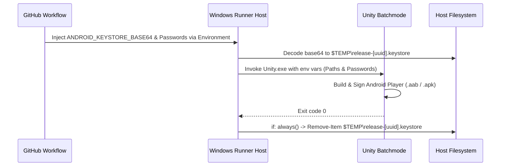

# Android Keystore Signing & Lifecycle Management

This document details the configuration, security lifecycle, and execution of Android cryptographic signing for APK and Android App Bundle (`.aab`) builds.

---

## 1. Overview & Google Play Requirements

Google Play requires all new production applications to be published as **Android App Bundles (`.aab`)** and signed with an upload key or release key.

`unity-build-pipeline` supports:
- Automatic switching between `.apk` (for internal side-loading/testing) and `.aab` (for store submission).
- Secure injection of signing credentials via GitHub Actions Secrets.
- Guaranteed cleanup of keystore material from self-hosted runner filesystems.

---

## 2. Generating a Release Keystore

If you do not already have an upload keystore, generate one using the Java `keytool` utility:

```powershell
keytool -genkey -v -keystore release.keystore `
    -alias releaseKey `
    -keyalg RSA -keysize 2048 -validity 10000 `
    -storepass "YourStrongStorePassword" `
    -keypass "YourStrongKeyPassword" `
    -dname "CN=Game Release, OU=Development, O=Company, L=City, ST=State, C=US"
```

---

## 3. Encoding Keystore for GitHub Actions Secrets

GitHub Secrets only store UTF-8 string values. To securely store binary `.keystore` or `.jks` files, encode the file as a base64 string:

```powershell
$keystoreBytes = [System.IO.File]::ReadAllBytes("release.keystore")
$base64String = [System.Convert]::ToBase64String($keystoreBytes)
$base64String | Set-Clipboard
Write-Host "Keystore base64 copied to clipboard!"
```

---

## 4. Configuring GitHub Repository Secrets

In your GitHub repository, navigate to **Settings** -> **Secrets and variables** -> **Actions** (or within a protected **Environment** like `production`), and add:

| Secret Name | Value | Description |
|---|---|---|
| `ANDROID_KEYSTORE_BASE64` | `MIIK...` | The full base64 string generated above. |
| `ANDROID_KEYSTORE_PASS` | `YourStrongStorePassword` | Password protecting the keystore file. |
| `ANDROID_KEYALIAS_NAME` | `releaseKey` | Alias name of the key pair inside the keystore. |
| `ANDROID_KEYALIAS_PASS` | `YourStrongKeyPassword` | Password protecting the specific key alias. |

---

## 5. Ephemeral In-Pipeline Lifecycle

To prevent long-term credential leakage on self-hosted build servers, `unity-build.yml` enforces a strict ephemeral lifecycle:



1. **Decoding:** The keystore is written to a unique, randomized temporary path in `$env:TEMP`.
2. **Environment Masking:** Passwords are never passed via command-line arguments (which appear in process monitors); they are consumed directly via environment variables.
3. **Guaranteed Cleanup:** The temporary keystore file is deleted unconditionally in an `if: always()` step, even if compilation or signing fails.
