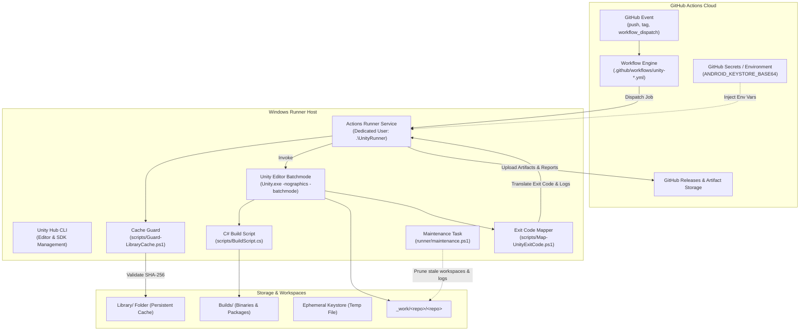
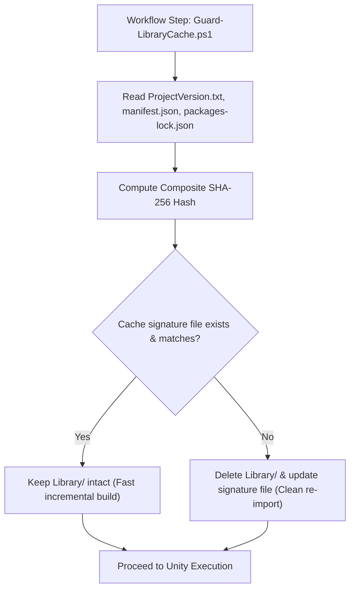

# Architecture & System Design: unity-build-pipeline

This document provides a comprehensive technical breakdown of the `unity-build-pipeline` architecture, detailing how self-hosted Windows hardware, Unity Hub CLI tooling, PowerShell automation, and GitHub Actions reusable workflows interact.

---

## 1. High-Level Architecture Overview

The system bridges GitHub Cloud Orchestration with on-premises or private cloud Windows build hosts:

---

## 2. Architectural Layers

### Layer 1: Host & Runner Provisioning Layer (`runner/`)
- **`install-runner.ps1`:** Downloads official GitHub Actions runner releases, verifies SHA-256 checksums, configures runner tokens, sets up runner labels (`unity,windows,x64`), and registers the runner as an automatic Windows Service running under a dedicated non-admin OS account (`.\UnityRunner`).
- **`install-unity.ps1`:** Automates Unity Hub installation, reads `ProjectSettings/ProjectVersion.txt` (detecting version and changeset), and idempotently installs the target Editor along with build target modules:
  - `android`: Android SDK, NDK, OpenJDK
  - `windows-il2cpp`: Windows IL2CPP support
  - `webgl`: WebGL build support
- **`license.ps1`:** Automates Unity licensing operations (online activation, return, status checks) using official Unity Hub and Editor CLI parameters.
- **`maintenance.ps1`:** Scheduled operational maintenance task that monitors host disk space, purges stale workspaces and old log files, and triggers runner binary updates.

### Layer 2: Automation & Pipeline Scripts Layer (`scripts/`)
- **`BuildScript.cs`:** Production-grade C# Editor script exposing static methods invoked via `-executeMethod`:
  - `BuildScript.PerformWindowsBuild`: Configures StandaloneWindows64 player, IL2CPP/Mono scripting backend, and output paths.
  - `BuildScript.PerformAndroidBuild`: Configures Keystore passwords, keystore alias, bundleVersionCode, and output APK or AAB formats.
  - `BuildScript.PerformWebGLBuild`: Configures WebGL compression and canvas settings.
- **`Guard-LibraryCache.ps1`:** Computes a composite SHA-256 fingerprint from:
  1. `ProjectSettings/ProjectVersion.txt`
  2. `Packages/manifest.json`
  3. `Packages/packages-lock.json`
  If the hash differs from the committed cache signature or if corruption is flagged, it safely purges `Library/` while preserving non-corrupted state.
- **`Map-UnityExitCode.ps1`:** Translates Unity's numeric exit codes into human-readable diagnostic error messages and GitHub Actions step annotations (`::error::...`).
- **`Resolve-BuildVersion.ps1`:** Resolves semantic version strings (`vX.Y.Z-preview.N+shortsha`) and generates monotonically increasing integer `bundleVersionCode` values for Android releases.

### Layer 3: GitHub Actions Reusable Workflows (`.github/workflows/`)
- **`unity-test.yml`:** Reusable workflow for EditMode and PlayMode test execution in batchmode with headless rendering (`-nographics`), publishing NUnit XML reports to the GitHub Actions Job Summary and step annotations.
- **`unity-build.yml`:** Reusable multi-target build matrix across Windows, Android, and WebGL, managing temporary keystores and publishing versioned artifacts.
- **`unity-release.yml`:** Triggered on version tags (`v*`), orchestrating build matrix execution and drafting GitHub Releases with attached build packages and checksums.

---

## 3. Storage & Cache Management Model

Unity's `Library/` directory contains compiled scripts, shader variant caches, and asset metadata. Rebuilding `Library/` from scratch is the single largest bottleneck in game CI.

| Strategy | Speed (Clean) | Speed (Incremental) | Network Cost | Host Isolation |
|---|---|---|---|---|
| **Hosted Runner + `actions/cache`** | 45-60 min | 15-25 min (tarball download) | High (10-30 GB transfer) | High (clean VM) |
| **Self-Hosted + Clean Workspace** | 40-50 min | 40-50 min (re-import) | Low | High |
| **Self-Hosted + Persistent Cache Guard (Chosen)** | 40-50 min | **2-4 min** | **Zero** | Controlled via Guard |

### Cache Guard Integrity Logic

---

## 4. Security Threat Model & Safeguards

| Threat Vector | Mitigation Strategy |
|---|---|
| **Malicious Pull Request Execution** | Workflows trigger strictly on `push` to protected branches and `workflow_dispatch`. Self-hosted runners are never exposed to untrusted fork PRs. |
| **Host Privilege Escalation** | Runner runs as a dedicated least-privilege Windows user account (`.\UnityRunner`), not `LocalSystem` or Administrator. |
| **Android Keystore Compromise** | Keystore passed as base64 secret in GitHub Environments, written to temporary file with restricted ACLs, and deleted in `if: always()` block. |
| **Supply Chain / Action Tampering** | 100% of third-party GitHub Actions are pinned to verified 40-character commit SHAs. |
| **Secrets Exposure in Build Logs** | Passwords passed via environment variables (never command line arguments); sensitive parameters masked using `::add-mask::`. |
